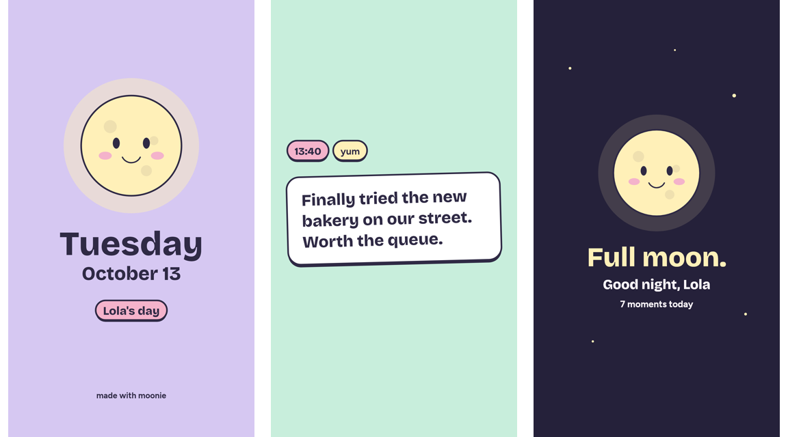

# Moonday 🌙

[](https://github.com/FeruzaAbdukayumova/moonday/actions/workflows/ci.yml)

Film little moments through the day. At night, Moonday turns them into one short vertical film.

You add clips, photos and one-line notes as the day goes on. Each moment keeps the time it happened and an optional vibe (cozy, lol, yum…). Moonie the moon fills up as the day gets moments. In the evening the app sends the day to a small render service, which cuts everything into a 9:16 film with title and end cards that you can save or share.



<sub>Real cards from the render service, drawn with the same palette and fonts as the app.</sub>

## What it does

- **Day timeline.** Moments are grouped by day, and a "day" ends at 04:00, not midnight, so a late-night snack still belongs to tonight.
- **Shot ideas for people who don't know what to film.** Pick a day plan (cozy day, city walk, busy day, friends) to get five shots with a tip on how to film each one. There's also a daily challenge that's the same for everyone on the same date.
- **Imports keep their real time.** Photos picked from the library are placed on the timeline by their EXIF time, not the import time.
- **Evening nudge.** A local notification at your chosen hour, cancelled as soon as you add something that day.
- **Memories.** A month calendar of past days, plus a streak counter.
- **Films stay fresh.** A saved film is dropped as soon as its day changes, so the next watch renders it again.

## How it's built

```
┌──────────────────────── phone ────────────────────────┐        ┌──────── render service (Node) ────────┐
│ Expo Router screens                                    │        │ POST /films   multipart upload        │
│   │                                                    │ upload │   ├ byte cap (declared + streamed)    │
│ src/lib  ── day.ts    day keys, 04:00 rollover, streak │ ─────► │   ├ manifest validation               │
│          ── db.ts     expo-sqlite, versioned migrations│        │   └ sniff file bytes → pinned demuxer │
│          ── shots.ts  day plans + daily challenge      │  poll  │ renderFilm: canvas cards + ffmpeg     │
│          ── film.ts   upload, poll, download           │ ◄───── │   segments → concat → film.mp4        │
│ media in the app's file system, metadata in SQLite     │        │ GET /films/:id, /films/:id/film.mp4   │
└────────────────────────────────────────────────────────┘        └───────────────────────────────────────┘
```

- **App:** Expo SDK 57, React Native 0.86, TypeScript, Expo Router. Everything is stored on the device. Moments live in SQLite (`expo-sqlite`), and the schema is upgraded with `PRAGMA user_version` migrations. Media files sit in the app's document directory.
- **Render service** (`server/`): plain Node 24 running TypeScript directly, with no framework. It uses the built-in `http` server and `Request.formData()` for multipart parsing. Cards are drawn with `@napi-rs/canvas` and the film is cut with ffmpeg.
- **Untrusted uploads.** The service never trusts the client's file type. It reads each file's magic bytes, allows only formats that fit the moment kind, and runs ffmpeg with that demuxer pinned and `-protocol_whitelist file`, so a crafted file can't make ffmpeg fetch URLs or read other files. Uploads are capped by `Content-Length` and again while streaming, which also covers chunked bodies. Jobs and files expire after 24 hours.
- **Fault-tolerant rendering.** One unreadable clip is skipped instead of failing the whole film.

## Run it

You need Node 24, ffmpeg (`brew install ffmpeg`) and the Expo Go app on a phone on the same Wi-Fi.

```bash
npm install && npm --prefix server install

npm run render        # render service on :4000
npx expo start        # then scan the QR code with Expo Go
```

The app finds the render service on the same machine as the Expo dev server. Set `EXPO_PUBLIC_RENDER_URL` to point it somewhere else.

## Tests

```bash
npm test              # app: Jest (jest-expo)
npm --prefix server test   # render service: node:test
```

- **App logic:** day keys and the 04:00 rollover across month, year and leap-day boundaries; streaks; EXIF parsing; the daily challenge rotation; shot-key uniqueness; vibes and moon mood.
- **Database:** the real SQL in `db.ts` runs against Node's built-in SQLite through a small adapter shaped like `expo-sqlite`. Covers migrating an old version-1 database without losing data, ordering, day summaries, settings and when saved films go stale.
- **Render service:** starts the real server and tests health and 404s, every manifest rule, rejecting files whose bytes don't match their kind, both upload caps, and a full ffmpeg render down to checking the MP4 bytes.

CI runs type checks, lint and both test suites, builds the iOS JavaScript bundle with `expo export`, and installs ffmpeg so the render test runs for real.

## License

MIT
